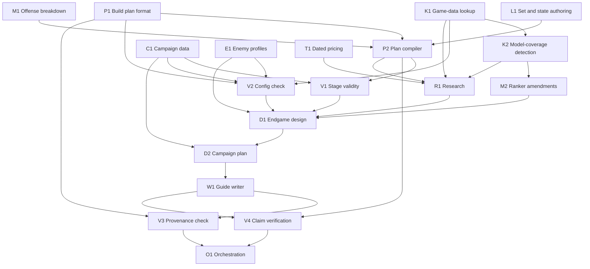

# Build-guide workflow: design (change-vision)

Status: from the design-bootstrap conversation of 2026-10-07.
- The user approved the shape (a staged pipeline around a build plan file) and adopted the recommended
  option on every open row.
- Phase 1 grounding is folded in; its reports are in `docs/design/grounding/`.
- The adversarial design review ran the same day. Its record is
  `docs/design/2026-10-07-build-guide-workflow-review.md`, and its confirmed findings are folded in below.
- Rows 47–49 await the user.

Next: `spec-formalizer`.

Marking used here:
- **Observed 2026-10-07.** Seen in this session's probe or source reads. Recon must re-verify these.
- **To ground.** An assumption, not yet a fact.

## North star

**What the user asked for.** A workflow that takes a PoE2 ascendancy and a main skill and produces two
things:
- a written build guide;
- a PoB2 build that you could hand to someone who has never seen the build.

The guide takes the player from level 1 through the campaign. It gives a passive tree, gear and skill
gems for each act and for each skill or gear swap. For late endgame it gives a budget variant and a
non-budget variant.

**Why.** The user has played PoE1 and PoE2 for years but has never built a character from scratch, and
describes their game knowledge as shallow. Anything thorough enough to give them the help they need will
be close to a public build guide anyway.

**The motivating use is the randomizer challenge.** A random ascendancy and skill are rolled (first roll:
Titan / Blood Hunt), and the build has to work anyway. Such a skill is often not meant to be a primary
damage dealer. Making it one takes thinking outside the box. That usually means finding unexpected
synergies between uniques, ascendancy nodes, support gems and keystones. The workflow also puts the
pob2-mcp server through its paces.

**What follows from the user being the guide's reader.** The user is the reader, not a fact-checker. So
the workflow has to check its own claims about game mechanics, and say plainly when it is guessing.

**What the user does not want.** See [Constraints and non-goals](#constraints-and-non-goals). The user
considers the boundaries well defined, if ambitious.

## Current state → target state

### Current state

To be verified by recon. The pob2-mcp server (77 tools, PoB2 pinned at v0.23.1) already offers:

- **Engine.** A session over a headless PoB2 engine. It holds one loaded build, with one lock per tool
  call. Lookup tools run inside the session too, and take the lock.
- **Tree.**
  - `search_tree_nodes`, which matches node names and stats.
  - `find_path_to_node`, `get_nearby_nodes`, and `get_passive_upgrades` (a measured ranking).
  - Spec management: `list_specs`, `select_spec`, `create_spec`, `delete_spec`, `rename_spec`.
- **Gems.**
  - `list_gems`: names, tags, and attribute weightings (not requirements).
  - `setup_skill_with_gems`, `add_gem`, and the level, quality and corruption setters.
  - `suggest_supports`: a measured ranking.
- **Items.** `add_item` and `add_multiple_items`, which take item text. Item sets can only be listed and
  selected (`list_item_sets`, `select_item_set`).
- **Skill sets and config sets.** No tools.
- **Config.** `get_config`, `set_config`, `set_enemy_stats` and config presets.
- **Checks.** `analyze_defenses`, `validate_build`, `get_build_issues`.
- **Planning and output.**
  - `plan_leveling`: a 0.5 act and interlude leveling outline. Grounding found it is a hand-written
    table with no area levels and no quest points. Its level targets are character levels (the earlier "6–9 too high" compared them with area
    levels). It is not reused
    (row 31).
  - `export_build_summary`.
- **Trade.** `find_upgrades`, `search_trade_items`, `get_item_price`, `trade_query_options`, and
  currency rates from poe.ninja. These are rate-limited and share limits with the user's account.

Gaps observed 2026-10-07 in the Titan / Blood Hunt probe and in source reads:

- **Offense output lacks breakdowns.** `lua_get_stats` with `category: 'offense'` returns 38
  main-skill fields: hit, speed, crit, ailment DPS. The default view shows only the DPS totals, which is
  what the probe saw. Per-skill and per-skill-part breakdowns are missing.
- **No skill-part selection.** `set_main_skill` cannot pick a skill's stat set (for example Blood
  Hunt's "Dash" or "Explosion"). PoB's UI can, through its stat-set dropdown (`Modules/Build.lua:375`).
- **No ascendancy listing.** `search_tree_nodes` cannot list an ascendancy's nodes; a "Titan" query
  matched names only. Grounding found two bugs in the same tool:
  - `node_type: 'any'` matches nothing;
  - results are cut off before they are sorted.
- **No gem text.** `list_gems` returns no description and no stat text. I had to grep `Data/Skills/*.lua`.
- **No PoE2 bosses.** PoB2's boss presets (`Data/BossSkills.lua`, `Data/Bosses.lua`) are PoE1 data
  (Shaper, Sirus, Maven, …).
- **Blood Hunt's payoff isn't computed.** The skill reported 284 DPS from the dash hit alone. No engine
  code references Blood Hunt's explosion or Blood Loss stats.
- **Lines PoB can't fully parse are dropped.** PoB never applies a mod line with an unparsed remainder
  (`Classes/Item.lua:2158`; the earlier cite of `:2138` was off). For example, "10% of Physical damage dealt by your Hits causes Blood Loss"
  parses only partly, so it contributes nothing.
- **The blind spots are pervasive.** Spike S-b's coverage census at the pin found:
  - 12.9% of unique mod lines are never applied;
  - about 30% of keystones and 32% of ascendancy notables have a line PoB ignores, including Titan's "Your
    Hits are Crushing Blows";
  - about 48.5% of supports describe a stat that PoB's stat map lacks. This is a heuristic and probably
    an overcount.

  Hand calculations are routine, not exceptions.

### Target state

Revised by the design review of 2026-10-07 (see `2026-10-07-build-guide-workflow-review.md`).

1. **Knowledge tools (K1).** These expose data the engine has already loaded:
   - gem info: description, skill parts with tooltip text from PoB's stat describer, quality effects,
     weapon requirement, and for supports what they can and can't support;
   - an ascendancy's nodes;
   - a unique search by name, mod text or slot, returning item text ready for `add_item`;
   - a mechanic keyword search across gems, uniques, passives and mods.

   They also fix the two `search_tree_nodes` bugs. These tools read engine memory, so they run inside the
   engine session and take its lock.
2. **Model-coverage tools (K2).** Each line gets one of these statuses:
   - fully parsed;
   - partly parsed;
   - parsed to nothing: an empty mod list, e.g. "+5 to any Attribute";
   - parsed but possibly unread: a mod or flag that nothing in PoB's calc code reads, e.g.
     `CharmsUseNoCharges`. This status is a heuristic.

   The check tries PoB's two-line join before calling a line unparsed. It also flags skill stats that are
   possibly unmodelled, which is a heuristic. The spike S-b census figures are therefore lower bounds.
3. **Ranker amendments (M2).** `suggest_supports` and `get_passive_upgrades` return a list of what PoB
   can't measure beside their ranking, and `get_passive_upgrades` can include ascendancy notables.
   These amend stabilization contracts (row 43).
4. **Measurement (M1).** A per-skill and per-skill-part breakdown, plus selecting the skill part.
   - `lua_get_stats` with `category: 'offense'` already returns 38 main-skill fields.
   - Selecting the part is a one-line engine change (`srcInstance.statSet[id] = i`).
5. **Set and state authoring (L1).**
   - Create, copy, rename and select item, skill and config sets directly (never PoB's `CopyLoadout`,
     which crashes on `{id}` names).
   - Loadout naming (row 3).
   - Weapon-set tags on passives (`allocMode` 1 or 2), and the second-weapon-set toggle used when
     measuring.
   - Attribute-node choices.
   - Tree jewels (stored on the tree spec) and jewel slots.
   - Flask and charm toggles.
   - The main skill at the same group index in every skill set, because the main skill is build-wide.
6. **Plan compiler (P2).** It compiles the plan into one PoB2 file with a loadout per stage. For each
   stage it:
   - sets a manual character level (the bridge's `set_level` path, which also moves the enemy level);
   - writes every relevant config value explicitly instead of trusting PoB's defaults;
   - measures, and stores the numbers in a compile record;
   - re-evaluates the hand-calculation ledger's formulas against those numbers.

   It saves the file at the highest stage's level (row 38) and produces the PoB2 import code (row 45).
7. **Stage checks.**
   - V1, validity: the checker computes every limit itself.
   - V2, config: two classes of config, plus an audit of defaults.
   - V3, provenance: over the plan, the dossier and the written guide.
   - V4, claim verification: by an independent agent (row 42).
8. **The pipeline (O1).** A Claude Code skill plus two saved workflows, split at checkpoint 1 (row 29):
   1. the research workflow;
   2. the concept pick;
   3. the design-and-write workflow.

   Failure paths are in row 41.
9. **Output.**
   - A per-guide folder in a configurable guides folder, outside the builds folder, holding:
     - `guide.md`, which includes the PoB2 import code;
     - the research dossier;
     - the plan;
     - the compile record.
   - The PoB2 file goes in the builds folder as a new file.

### Stays untouched

These are the stabilization epic's contracts, except for the ranker amendments named in row 43:
- the existing tool contracts;
- the engine session's lock and recovery;
- `buildFileWriter`: back up first, and refuse to overwrite a file that changed on disk;
- the trade rate limiter and its rules;
- the offline test rules.

New tools follow the same conventions.

## Capabilities and dependencies (the proto-DAG)

| ID | Capability | Purpose |
|---|---|---|
| K1 | Game-data lookup | Gem info, ascendancy nodes, unique search, mechanic keyword search, all from PoB's loaded data |
| K2 | Model-coverage detection | Per-line parse status (including "parsed to nothing" and two-line joins), possibly unread mods, possibly unmodelled skill stats, config coverage gaps |
| M1 | Offense breakdown and skill-part selection | Per-skill and per-skill-part numbers that hand calculations build on |
| M2 | Ranker amendments | Rankers list what PoB can't measure beside the ranking (row 43) |
| L1 | Set and state authoring | Sets and loadout naming, weapon-set passives, attribute choices, jewels, flask and charm toggles, a consistent main-skill index |
| P1 | Build plan format | The pin, tree and game versions. Stages, each with: its level; its tree, with weapon-set tags and attribute choices; jewels, items and gems; config split into earned player state and scenario inputs. A source per claim. The ledger, as formulas over named compile outputs |
| P2 | Plan compiler | Plan → PoB2 file with loadouts, a per-stage compile record, the re-evaluated ledger, and the import code |
| C1 | Campaign reference data | Acts and interludes, area levels (interlude levels are dynamic), the passive and weapon-set point schedule, ascendancy-trial gates, quest rewards and the resistance penalty per act, gem availability by tier |
| E1 | Enemy reference profiles | **Boss:** datamined base hits by type, 0.5.5 resistances, and fight life with a stated confidence (it is unpublished). **Map monsters:** PoB's monster life and damage tables at the area level, with waystone modifiers and rarity and variety multipliers from external sources. Hits and resistances go into config as scenario inputs; life stays in the dossier |
| T1 | Dated pricing | Paced price checks within the server's rate limits, cached within a run. Priority: concept key items, then each variant's full slot list, then campaign uniques. Each price is dated and names its league |
| V1 | Stage validity check | Computes every level- and act-gated limit itself: passive and weapon-set points, ascendancy points by trial gate, gem and item level requirements, and attributes including attribute-node choices. Filters PoB's informational warning lines |
| V2 | Config check | Earned player state names its producer: an item, gem, passive, skill, or flask/charm toggle. Scenario inputs name their source, E1 or C1. A default audit flags any default-on value the stage hasn't justified |
| V3 | Provenance check | Every claim in the plan, the dossier and the written guide carries its source tag |
| V4 | Claim verification | An agent that didn't write the plan re-derives each ledger entry, checks a sample of sourced claims against their sources, and reads the guide's prose for unsupported mechanics claims |
| R1 | Research stage | **R1a:** parallel, lookup-only research producing the mechanics dossier, the synergy search and 2–3 concept proposals. **R1b:** the coordinator compiles each concept's skeleton, measures it and prices its key items |
| D1 | Endgame design stage | Budget and non-budget variants, each with its character level, gem levels and ascendancy points stated (row 46) |
| D2 | Campaign plan stage | Leveling skills, breakpoints and each stage's loadout, planned backward from D1. Trees grow stage to stage, with respecs only at named points (row 44) |
| W1 | Guide writer | `guide.md`, rendered from the plan, the compile record, the ledger and the dossier, with the import code |
| O1 | Orchestration | The skill, two workflows split at checkpoint 1, failure paths and retry caps |

Build order: what must exist before what.

Why each edge exists:
- **K2 needs K1.** The skill-stat flag reads gem and skill data.
- **M2 needs K2.** A ranker can flag what it can't measure only once coverage detection exists.
- **P2 needs L1, P1 and M1.** The compiler writes the plan's stages and state, and records the
  breakdown per stage.
- **V1 needs P2 and C1.** V1 checks compiled loadouts against level and act gates.
- **V2 needs P1, K1, E1 and C1.** Earned state is matched against producers. Scenario inputs are
  matched against the enemy profiles and campaign data.
- **V3 and V4 need W1.** They check the written guide as well as the plan. V4 also needs P2's compile
  record to re-derive the ledger.
- **R1 needs K1, K2, P2 and T1.**
  - R1a uses only the lookups (K1, K2).
  - R1b compiles and measures concept skeletons (P2) and prices them (T1).
- **D1 needs R1, M2, E1, V1 and V2.** D1's loadouts must pass V1 and V2 before D2 plans backward from
  them.
- **D2 needs D1 and C1.**
- **W1 needs D2.**
- **O1 needs V3 and V4,** and through them everything else.

Run order of one guide, distinct from the build order above:
1. R1a, in parallel and lookup-only.
2. R1b, through the coordinator.
3. **Checkpoint 1:** the concept pick.
4. D1: compile, measure, pass V1 and V2, price.
5. D2: compile, pass V1 and V2.
6. W1.
7. V3 and V4 over the plan, the dossier and the guide.
8. **Checkpoint 2:** the final guide.

A failure at any step follows row 41.

Spikes, all run on 2026-10-07 (results in `docs/design/grounding/`):
- **S-a, compile feasibility: confirmed.** All four set types and `{id}` names survive a headless save
  and reload, and the loadouts work.
- **S-b, model-coverage census: done.** The figures are lower bounds (see K2).
- **S-c, engine sharing: confirmed.** Agents using the session's server share one engine.

## Decisions

| # | Decision | Status | Rationale / what unblocks it |
|---|---|---|---|
| 1 | Output is a written guide plus a PoB2 build that someone who has never seen the build can follow | settled | North star |
| 2 | Shape: a staged pipeline around a build plan file | settled (user approved) | Context stays small per stage, verification is independent, any stage can be regenerated. Rejected: one conversation guided by a skill (one context, no independent check of claims); stages editing the PoB file directly (forced sequencing, sources kept apart from the build, redoing a stage means undoing edits); a rule-based server-side generator (rules can't supply creativity) |
| 3 | Each guide stage is a PoB2 loadout. Shared sets use `{id}` lists, e.g. `Early Game {1,2}` | settled; confirmed at the pin (spike S-a) | All four set types and `{1,2}` names survive a headless save and reload, and the loadouts list and switch. Constraints: braces hold only letters, digits and commas, with no spaces; the loadout's name comes from its tree set; the compiler never uses PoB's `CopyLoadout` on `{id}` names (it crashes); character level is build-wide (row 38) |
| 4 | Endgame is designed first; the campaign is planned backward from it | settled | Leveling choices serve the endgame target |
| 5 | Every claim shows its source: PoB-computed, PoB game data, external (linked), or judgment | settled (constraint 1) | The reader can't fact-check |
| 6 | PoB numbers are used only where PoB models the mechanic. Otherwise: a hand calculation with stated assumptions | settled (constraint 2) | Probe evidence (Blood Hunt) |
| 7 | Each guide names its engine data version (the PoB pin and the game patch it targets) and, separately, the patch its prices and boss data come from | settled; revised by review | Guides go stale with patches. A single patch isn't achievable until the pin catches up (row 40), so the first guide states 0.5.4 engine data with 0.5.5 prices and boss resistances |
| 8 | Each campaign preset is valid at its level: points, gem and item level requirements, attributes, PoB warnings | settled (constraint 4) | Machine-checkable |
| 9 | The player is in a trade league. Buyable uniques are allowed in campaign presets; hard-to-get drops (boss-only, league-locked) are not. Availability is judged from dated trade listings. Rares are affix targets | settled (constraint 5, amended by the user) | Well-rolled rares usually cost far more than uniques |
| 10 | The leveling skill may differ from the main skill. A conventional leveling build carries until the main skill's level requirement | settled (constraint 6) | User |
| 11 | Budget ceilings are real prices, checked on the trade site at generation and dated | settled (constraint 7) | Prices go stale fast |
| 12 | Trade and poe.ninja requests go through the server only, from one coordinator, within a per-guide search budget. Web research is allowed | settled (constraint 8) | Rate limits are shared with the user's account. On 2026-10-07, poe2wiki.net and mobalytics refused agent fetches; poe2db.tw, maxroll.gg and game8 worked |
| 13 | The plan is the source of truth. The compiler builds the PoB file and a compile record from it. The guide's numbers come from the compile record and the ledger (re-evaluated at compile), from dated price checks, and from E1. The PoB file holds the build state. The PoB file is written as a new file, never over an existing one | settled; revised by review | Level, main skill and level mode are build-wide in PoB2 (`Modules/Build.lua:1153-1161`), so an early loadout opened in PoB shows that stage's numbers only once the reader sets its level (rows 38, 49) |
| 14 | Config has two classes. **Earned player state** (stacks, charges, conditions, flask and charm toggles) names the item, gem, passive or skill that produces it, and the guide explains its uptime. **Scenario inputs** (enemy settings, waystone modifiers, quest rewards, the resistance penalty, the enemy level) name their source, E1 or C1. The compiler writes every relevant value explicitly, and a default audit flags unjustified default-on values | settled; revised by review | Inflated config is how PoB builds overstate themselves. PoB's quest-reward checkboxes default to on (`Modules/ConfigOptions.lua:78`), so an Act 1 set silently gets 100 Spirit. Only non-default values are saved (`Classes/ConfigTab.lua:739`) |
| 15 | No encounter input; the goal is "as strong as possible" within each variant's budget | settled | User |
| 16 | Budget variant: about 20 divines or less (less is better). Target: T15 maps (area 79) without dying often. The repeatable (non-quest) Arbiter of Divinity is a reported sanity check, not a gate | settled; revised by review | User: such builds usually manage it, and the user's Grenadator beat it easily on the first try. 0.5 has no "Uber" versions. The guide reports max hit against its datamined hits, and time-to-kill under E1's stated life assumption (about twice the quest version's life; community reports, low confidence) |
| 17 | Non-budget variant: about 200 divines as the reference point (a practical ceiling, not a hard cap). Target: high-difficulty scaled maps: T16 (area 80, where base monster life jumps 25%) up to area 82, with heavily modded waystones and tablets | settled; made concrete by grounding | User: richer players are pros who don't need guides |
| 18 | "As strong as possible" means meeting a survival floor first (capped resistances, max hit taken above the reference hits), then spending everything else on damage, within budget | settled (the user didn't object) | Resistances are checked at PoB's Endgame penalty setting (−60%) |
| 19 | Endgame checks. **Gates:** the survival floor (capped resistances; max hit taken above the reference hits). **Reported with confidence:** time-to-kill and the mapping signals. Every config set states `enemyIsBoss` explicitly. Mapping reference hits come from PoB's monster damage table at the area level, with waystone damage modifiers | settled; revised by review | User approved the checks. Time-to-kill is a hand calculation (sourced life ÷ DPS) because PoB has no enemy-life input. PoB's default enemy is a Pinnacle boss |
| 20 | Guides are mapping builds that can kill the pinnacle bosses (0.5's repeatable non-quest fights) with some extra effort. One loadout has a one-click clear skill for normal and magic packs, plus a single-target build/spend/debuff setup. When forced to choose, favor mapping | settled | User |
| 21 | Clear-speed signals: movement speed first, then clicks per pack (damage and AoE). These are judgment signals; PoB doesn't score clear speed | settled | User |
| 22 | The rolled skill is the main source of damage: it kills the enemies. Other skills may complement it. In the endgame it is the clear skill or the single-target payoff (research decides which), never a token role | settled | User |
| 23 | Combo and buff states come from config stacks where PoB2's config covers them, and from hand calculations where it doesn't (coverage is patchy). Research lists the config gaps | settled | User |
| 24 | Research produces 2–3 concepts (synergy packages: key uniques, ascendancy nodes, supports, keystones; a feasibility read; key prices; risks). The user picks one at checkpoint 1. Research runs in two parts: lookup-only agents in parallel (R1a), then the coordinator compiles, measures and prices each concept (R1b) | settled; split by review | User. Engine and trade work can't run in parallel agents (rows 12, 30) |
| 25 | User checkpoints: (1) the concept pick after research; (2) the final guide. A concept that proves infeasible in endgame design returns to checkpoint 1 with evidence (row 41) | settled | Agreed with the shape. No routine checkpoint after endgame design (row 34) |
| 26 | The guide is markdown in a per-guide folder (guide, dossier, plan) inside a configurable guides folder outside the builds folder. It includes the PoB2 import code | settled | User chose markdown over a published page |
| 27 | Cost envelope per guide | settled (the user adopted the recommendation, 2026-10-07) | Cap the first run (Titan / Blood Hunt) at 3 concepts and 3 verify lenses, measure it, then set the envelope. Each stage retries at most twice after a failed check, then escalates to the user |
| 28 | Plan file format and schema | settled (the user adopted the recommendation, 2026-10-07) | A formalizer decide-and-record. Adopted: YAML or JSON with a JSON Schema, validated by P2 |
| 29 | The pipeline is a skill plus two saved workflows, split at checkpoint 1 | settled; grounded and revised by review | A skill can start a saved workflow (platform grounding §2). Pausing inside a running workflow for the user's pick is unverified, so the skill holds the hand-off between the two workflows |
| 30 | Engine concurrency | settled; confirmed by grounding, premise corrected by review | Agents using the session's server share one engine (platform grounding §1). Every step that changes the loaded build or calls trade runs through one coordinator. Lookups read engine memory and take the session lock too (`src/server/toolRouter.ts:161`), but they are short and only queue. A per-agent inline MCP server is a later option for parallel compiles; it isn't probed yet |
| 31 | Campaign data source | settled; revised by grounding | PoB's `Data/QuestRewards.lua` matches the live campaign (24 passive points, 24 weapon-set points, 100 Spirit). `Data/WorldAreas.lua` supplies area levels, plus external sources for the interludes, whose levels are dynamic (+8 by play order). Gem availability: an uncut skill gem of level N cuts any skill of tier N or below. `plan_leveling`'s data is not reused |
| 32 | Mapping-strength estimate | settled; revised by review | A hand calculation: the clear skill's hit against PoB's monster life table at the area level (PoB game data; area 79 base 24,852), times waystone life modifiers and rarity and variety multipliers. Those multipliers come from external sources, because PoB has none. For the area 80–82 target, the estimate is a stated judgment. Movement speed and AoE are judgment signals |
| 33 | Pricing is paced, not capped. Searches run within the server's rate-limit windows, cached within a run, in priority order: concept key items, then each variant's full slot list (rares priced as affix-target searches), then campaign uniques. Each price is dated and names its league | settled; revised by review | The earlier cap of 12 came from a 60-second burst figure. The limiter's windows (up to 6 h) bound the pace, not a per-guide total. The ceiling check needs every slot priced |
| 34 | A checkpoint after endgame design, before campaign planning | settled (the user adopted the recommendation, 2026-10-07) | Adopted: no. Add it if the first run shows endgame mistakes leaking into the campaign plan |
| 35 | Guides folder default location and its setting | settled (the user adopted the recommendation, 2026-10-07) | Adopted: an environment variable with a default outside the builds folder |
| 36 | Marketplace plugin packaging (server plus skill, hosted in the GitHub repo) | deferred | Unblocked when the tooling is feature-complete and stable |
| 37 | Unique-jewel trade rows (deferred in the stabilization epic) | deferred | Unchanged; relevant to the non-budget variant later |
| 38 | Character level is build-wide in PoB2, not per loadout | settled (user, 2026-10-07) | The file's level is the highest stage's level. Compile measures each stage at its own level. Loadout names carry the level, e.g. `Act 2 (L25) {2}`. The guide tells readers to set that level when inspecting an early loadout. The validity check (V1) takes each stage's level from the plan |
| 39 | Game updates: 1.0 ships 2026-12-11. Every league brings sizeable changes, and balance patches within a league are frequent | settled (user, 2026-10-07) | Build the tooling now; it doesn't depend on the game version. After a pin upgrade, a guide is regenerated by re-running compile and checks on its plan, which records its versions. A stage re-runs only where the checks fail or the patch notes touch its mechanics. GGG's patch notes are the primary source for what changed. Agents read them from mirrors; fetching from pathofexile.com needs the user's approval |
| 40 | Upgrade the PoB2 pin to 0.5.5 data, the active league the user plays | deferred (user, 2026-10-07) | No PoB2 release has shipped since v0.23.1 (2026-07-28, targeting game 0.5.4). Dev has "Export 0.5.5 data and update trade data" (#2505, 2026-09-10). The user chose to keep the release-tag rule and wait. Unblocked by the next PoB2 release |
| 41 | Failure paths | settled (review fold-back) | **No viable concept:** checkpoint 1 shows the best attempts and why each fails; the user picks one anyway, asks for more, or stops. **Concept infeasible in D1** (floor unmet, over budget, or the rolled skill not the main damage source): back to checkpoint 1 with evidence. **Failed check:** the responsible stage re-runs with the verifier's findings, at most twice (row 27), then escalates |
| 42 | Claims are verified for truth, not just tagged (V4). An agent that didn't write the plan re-derives each ledger entry, checks a sample of sourced claims against their sources, and reads the guide's prose | settled (review fold-back) | The north star says the workflow checks its own claims. V3 only checks that a tag exists |
| 43 | Ranker contract amendments. `suggest_supports` and `get_passive_upgrades` return a list of what PoB can't measure beside their ranking, and `get_passive_upgrades` can include ascendancy notables. This amends stabilization D-77 and D-78's result shape; AC-E39's ordering is kept | settled (review fold-back) | Today unmeasurable candidates fall off the end or are excluded. Ascendancy notables, a third of which have unapplied lines, never reach the ranker |
| 44 | Tree continuity: each stage's tree contains the previous stage's, except at named respec points (e.g. the switch from the leveling skill). The guide lists those with their gold cost | settled (review fold-back) | A reader shouldn't respec at every stage |
| 45 | The compiler produces the PoB2 import code, and the guide includes it | settled (review fold-back) | No current tool encodes a code (`src/utils/buildCode.ts` only decodes) |
| 46 | Each endgame variant states its character level, gem levels and ascendancy points | open: formalizer decide-and-record | Leading option: use what the grounded public guides assume (to ground). V1 needs these to check the endgame loadouts |
| 47 | Budget variant objective | open: needs the user | Rows 15/18 say "as strong as possible within about 20 divines"; row 16 says "less is better" for a T15 target. Leading option: meet the T15 target at the lowest cost, never above about 20 divines; the non-budget variant is as strong as possible around 200 |
| 48 | The rolled skill's role while mapping | open: needs the user | Row 22 lets research make the rolled skill either the clear skill or the single-target payoff, but mapping is favored (row 20) and the rolled skill must "kill the enemies". Leading option: prefer the clear role. Allow the single-target role only when the skill can't clear, and say so in the guide |
| 49 | Save the PoB file in auto-level mode | open: needs the user | In auto mode, PoB2 re-estimates the character level from the active tree's points whenever the reader switches loadouts (`Modules/Build.lua:1001-1017`). Early loadouts would then show roughly their own level without a manual step. The compiler still measures at the plan's levels. If adopted, this replaces row 38's instruction to set the level by hand |

## References to ground

| Reference | Assumption riding on it | How to verify |
|---|---|---|
| PoB2 loadouts at pin v0.23.1 | The naming scheme in the dev checkout's `help.txt` also holds at the pin; a headless save keeps all four set types | Read the pinned source (`Classes/BuildSetService.lua`, `ConfigSetListControl.lua`, the item and skill set code); spike S-a |
| PoB2 data in the engine | Gem descriptions, skill parts, the stat describer (`Modules/StatDescriber.lua`), ascendancy nodes, uniques as item text (`Data/Uniques/*.lua`) and mod parse status (`Data/ModCache.lua`'s remainder field) are reachable from the bridge | Read the pinned source and probe the bridge |
| Unparsed item lines are dropped | `Classes/Item.lua:2138` skips any mod line with an unparsed remainder | Re-read in recon (observed 2026-10-07) |
| Skill-stat coverage heuristic | A skill stat absent from `Data/SkillStatMap.lua` is probably unmodelled, but special-case calc code exists | Spike S-b: sample known cases |
| Custom enemy config at the pin | Per-damage-type enemy damage, enemy life (if any), and `enemyIsBoss` levels can be set to externally sourced values | Read the pinned `Modules/ConfigOptions.lua`; probe `set_config` |
| PoB monster life tables | Usable to estimate "one-click kill" at T15 area level | Read the pinned `Data/Misc.lua` and the calc code |
| Campaign structure for the pinned patch | Acts, interludes, area levels, quest passive points, ascendancy trials, gem availability by level (the `Tier` field in `Data/Gems.lua`) | PoB data plus poe2wiki and poe2db; check `plan_leveling`'s data |
| T15 area level and monster stats | The baseline for the budget variant's checks | poe2db and poe2wiki |
| Non-quest Arbiter of Divinity | Life and big hits by damage type, for the sanity check | poe2db and poe2wiki |
| Live game version vs. the pin | The pin's data matches the live patch closely enough for a guide | Compare the pin's game version with the current patch; upgrading the pin is a user decision |
| Claude Code subagents and MCP | Workflow agents share the session's MCP servers, and so the single engine | `claude-code-guide`; spike S-c |
| Skill → saved workflow | A skill's instructions can launch a saved workflow | Workflow tool docs and `claude-code-guide` |
| Public build guides (prior art) | The expected sections and depth of a guide "close to a public build guide" | Short research pass on two or three well-regarded PoE2 guides; feeds W1's template |
| Server rate limiter | The per-guide search budget fits the trade limits | Read `src/trade/rateLimiter.ts` and the stabilization spec's trade contracts |

Grounded on 2026-10-07. The verdicts are in `docs/design/grounding/`: `2026-10-07-pob-pin-and-spikes.md`,
`2026-10-07-claude-code-platform.md` and `2026-10-07-external-game-data.md`. They are folded into the rows
above. Still open:
- the magic and rare monster life multipliers;
- whether `mise` is on PATH for a plugin's server process;
- an inline per-agent MCP server, which is not yet probed.

## Quality bar (vision level)

- **A reader who has never seen the build can follow it from level 1 to endgame.** At each stage they
  know what to allocate, what to equip or buy (with a dated price), which gems to link, when to swap and
  respec, and why.
- **The PoB2 file works on import.**
  - It has one loadout per stage.
  - Each stage passed the validity check at its level when compiled.
  - Readers see a stage's own numbers once its level is set (rows 38, 49).
  - The guide includes the import code.
- **Every mechanics claim shows its source, and is checked.**
  - Numbers come from the compile record, the ledger (re-evaluated at compile and re-derived by V4),
    dated prices, or the enemy profiles.
  - Earned config names its producer; scenario config names its source.
  - Confidence is stated wherever PoB can't verify.
- **Each endgame variant has its numbers in the guide:**
  - it meets the survival floor (a gate);
  - the budget variant stays under its ceiling as of the dated check, and the non-budget variant states
    its total against the reference of about 200 divines;
  - its mapping signals are assessed;
  - the non-quest Arbiter result is reported.
- **The rolled skill is visibly the main source of damage** in the endgame loadouts. Where PoB can't
  compute its payoff, the ledger shows it.
- **The concepts are recorded.** The guide explains the chosen concept and why it won; the dossier keeps
  the alternatives.
- **The final test is the user playing it.** The first run, Titan / Blood Hunt, produces a guide the user
  can actually level and map with.

## Constraints and non-goals

Constraints:
- **Decisions 5–14** (the ten constraints agreed in conversation).
- **The project's standing rules:**
  - no secrets in files, logs or argv;
  - trade and poe.ninja only through the server;
  - writes to the builds folder only through `buildFileWriter`;
  - no network access in tests;
  - no agent ever reads `.env`.
- **PoE2 only, bound to the PoB2 pin.**
- **Cost is a stated concern.** Fan-out is kept judicious (row 27).

Non-goals:
- **Dedicated boss-killer builds.** These are niche and expensive, financed by a separate mapper, and
  built on long setup combos.
- **An encounter-specific target input.**
- **Live tracking of the player's character.** Character import isn't available to us.
- **An in-game overlay or automation.**
- **Hosting or publishing guides.** The user shares them.
- **Re-checking guides after game patches.**
- **PoE1.**
- **Perfect simulation.** Hand calculations are accepted and labelled.
