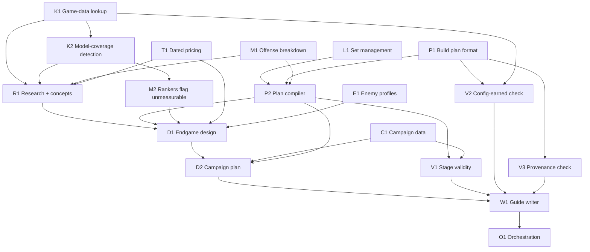

# Build-guide workflow: design (change-vision)

Status: from the design-bootstrap conversation of 2026-10-07. The user approved the shape (staged pipeline
around a build plan file) and adopted the recommended option on every open row. Phase 1 grounding ran on 2026-10-07. Its three reports are in `docs/design/grounding/`, and their verdicts
are folded in below. Rows 38 and 39 are new and await the user. Next: an adversarial vision review, then
`spec-formalizer`.

Marking used here:
- **Observed 2026-10-07.** Seen in this session's probe or source reads. Recon must re-verify these.
- **To ground.** An assumption, not yet a fact.

## North star

**What the user asked for.** A workflow that takes a PoE2 ascendancy and a main skill and produces two
things:
- a written build guide;
- a PoB2 build that you could hand to someone who has never seen the build.

The guide takes the player from level 1 through the campaign. It gives a passive tree, gear and skill
gems for each act and for each skill or gear swap. For late endgame it gives a budget variant and a
non-budget variant.

**Why.** The user has played PoE1 and PoE2 for years but has never built a character from scratch, and
describes their game knowledge as shallow. Anything thorough enough to give them the help they need will
be close to a public build guide anyway.

**The motivating use is the randomizer challenge.** A random ascendancy and skill are rolled (first roll:
Titan / Blood Hunt), and the build has to work anyway. Such a skill is often not meant to be a primary
damage dealer. Making it one takes thinking outside the box. That usually means finding unexpected
synergies between uniques, ascendancy nodes, support gems and keystones. The workflow also puts the
pob2-mcp server through its paces.

**What follows from the user being the guide's reader.** The user is the reader, not a fact-checker. So
the workflow has to check its own claims about game mechanics, and say plainly when it is guessing.

**What the user does not want.** See [Constraints and non-goals](#constraints-and-non-goals). The user
considers the boundaries well defined, if ambitious.

## Current state → target state

### Current state

To be verified by recon. The pob2-mcp server (77 tools, PoB2 pinned at v0.23.1) already offers:

- **Engine.** A session over a headless PoB2 engine. It holds one loaded build, with one lock per tool
  call.
- **Tree.**
  - `search_tree_nodes`, which matches node names and stats.
  - `find_path_to_node`, `get_nearby_nodes`, and `get_passive_upgrades` (a measured ranking).
  - Spec management: `list_specs`, `select_spec`, `create_spec`, `delete_spec`, `rename_spec`.
- **Gems.**
  - `list_gems`: names, tags, requirements.
  - `setup_skill_with_gems`, `add_gem`, and the level, quality and corruption setters.
  - `suggest_supports`: a measured ranking.
- **Items.** `add_item` and `add_multiple_items`, which take item text. Item sets can only be listed and
  selected (`list_item_sets`, `select_item_set`).
- **Skill sets and config sets.** No tools.
- **Config.** `get_config`, `set_config`, `set_enemy_stats` and config presets.
- **Checks.** `analyze_defenses`, `validate_build`, `get_build_issues`.
- **Planning and output.**
  - `plan_leveling`: a 0.5 act and interlude leveling outline. Grounding found it is a hand-written
    table with no area levels and no quest points. Its levels run 6–9 too high, so it is not reused
    (row 31).
  - `export_build_summary`.
- **Trade.** `find_upgrades`, `search_trade_items`, `get_item_price`, `trade_query_options`, and
  currency rates from poe.ninja. These are rate-limited and share limits with the user's account.

Gaps observed 2026-10-07 in the Titan / Blood Hunt probe and in source reads:

- **Offense output is thin.** `lua_get_stats` reported only `CombinedDPS` and `TotalDPS`. It gave no
  per-skill hit, speed, crit or ailment breakdown.
- **No skill-part selection.** `set_main_skill` cannot pick a skill's stat set (for example Blood
  Hunt's "Dash" or "Explosion"). PoB's UI can, through its stat-set dropdown (`Modules/Build.lua:375`).
- **No ascendancy listing.** `search_tree_nodes` cannot list an ascendancy's nodes; a "Titan" query
  matched names only. Grounding found two bugs in the same tool:
  - `node_type: 'any'` matches nothing;
  - results are cut off before they are sorted.
- **No gem text.** `list_gems` returns no description and no stat text. I had to grep `Data/Skills/*.lua`.
- **No PoE2 bosses.** PoB2's boss presets (`Data/BossSkills.lua`, `Data/Bosses.lua`) are PoE1 data
  (Shaper, Sirus, Maven, …).
- **Blood Hunt's payoff isn't computed.** The skill reported 284 DPS from the dash hit alone. No engine
  code references Blood Hunt's explosion or Blood Loss stats.
- **Lines PoB can't fully parse are dropped.** PoB never applies a mod line with an unparsed remainder
  (`Classes/Item.lua:2158`; the earlier cite of `:2138` was off). For example, "10% of Physical damage dealt by your Hits causes Blood Loss"
  parses only partly, so it contributes nothing.
- **The blind spots are pervasive.** Spike S-b's coverage census at the pin found:
  - 12.9% of unique mod lines are never applied;
  - about 30% of keystones and 32% of ascendancy notables have a line PoB ignores, including Titan's "Your
    Hits are Crushing Blows";
  - about 48.5% of supports describe a stat that PoB's stat map lacks. This is a heuristic and probably
    an overcount.

  Hand calculations are routine, not exceptions.

### Target state

1. **Knowledge tools.** These expose data the engine has already loaded, so nothing needs grepping:
   - gem info: description, skill parts with tooltip text from PoB's stat describer, quality effects,
     weapon requirement, and for supports what they can and can't support;
   - an ascendancy's nodes;
   - a unique search by name, mod text or slot, returning item text ready for `add_item`;
   - a mechanic keyword search across gems, uniques, passives and mods (for example "Blood Loss" or
     "Crushing Blow").
2. **Model-coverage tools.**
   - A mod-line check: fully parsed, partly parsed, or not parsed. PoB itself reports this, so it is
     reliable.
   - A skill-stat flag for stats that are possibly not modelled. This one is a heuristic.
   - In the measured rankers (`suggest_supports`, `get_passive_upgrades`), candidates that PoB cannot
     measure go in their own list, instead of ranking last at +0%.
   - The mod-line check re-parses each line on its own. ModCache's stored remainder can include the
     next line's text.
3. **Measurement tools.** An offense breakdown per skill and per skill part (hit, speed, crit, ailment
   DPS), and skill-part selection. Selecting the part is a one-line engine change
   (`srcInstance.statSet[id] = i`). The existing `skill_part` path only drives PoE1-style parts.
4. **Loadout tools.**
   - Create, copy, rename and select item sets, skill sets and config sets.
   - Loadout naming that follows PoB2's linking scheme (row 3). The compiler creates each set directly;
     it never calls PoB's `CopyLoadout`, which crashes on `{id}` names.
5. **Plan compiler.** A build plan file is compiled into one PoB2 file with a loadout per stage. The
   compiler also records PoB's numbers for every stage.
6. **Stage checks.**
   - Each stage is valid at its level.
   - Each config value is earned.
   - Each claim has a source.
7. **The pipeline.** A Claude Code skill plus a saved workflow runs research → endgame design → campaign
   plan → compile → verify → write, with the user's checkpoints.
8. **Output.**
   - A per-guide folder in a configurable guides folder, outside the builds folder, holding:
     - `guide.md`, which includes the PoB2 import code;
     - the research dossier;
     - the plan.
   - The PoB2 file goes in the builds folder as a new file.

### Stays untouched

These are the stabilization epic's contracts:
- the existing tool contracts;
- the engine session's lock and recovery;
- `buildFileWriter`: back up first, and refuse to overwrite a file that changed on disk;
- the trade rate limiter and its rules;
- the offline test rules.

New tools follow the same conventions.

## Capabilities and dependencies (the proto-DAG)

| ID | Capability | Purpose |
|---|---|---|
| K1 | Game-data lookup | Gem info, ascendancy nodes, unique search, mechanic keyword search, all from PoB's loaded data |
| K2 | Model-coverage detection | Whether PoB parses a mod line, which skill stats are possibly unmodelled, config coverage gaps |
| M1 | Offense breakdown and skill-part selection | The engine numbers that hand calculations build on |
| M2 | Rankers flag what PoB can't measure | Keeps measured rankings from silently burying the real payoff |
| L1 | Set management | Item, skill and config sets; loadout naming |
| P1 | Build plan format | Stages and their tree, items, gems and config; a source per claim; the hand-calculation ledger |
| P2 | Plan compiler | Plan → PoB2 file with loadouts, plus PoB's numbers per stage |
| C1 | Campaign reference data | Acts and interludes, area levels, quest passive points, gem availability by level |
| E1 | Enemy reference profiles | Externally sourced boss and map-monster life and hits. The hits go into config; the life stays in the dossier for hand calculations, because PoB has no enemy-life input |
| T1 | Dated pricing | Price checks for key uniques and affix-target rares, within a per-guide search budget |
| V1 | Stage validity check | Points vs. level plus quest points, gem and item level requirements, attributes, PoB warnings |
| V2 | Config-earned check | Each non-default config value names its producing source in that stage's loadout |
| V3 | Provenance check | Every claim in the guide carries its source tag |
| R1 | Research stage | Mechanics dossier plus 2–3 build concepts for the user to pick from |
| D1 | Endgame design stage | Budget and non-budget variants of the chosen concept |
| D2 | Campaign plan stage | Leveling skills, breakpoints, and each stage's loadout, planned backward from D1 |
| W1 | Guide writer | `guide.md` rendered from the plan, the compiled numbers and the dossier |
| O1 | Orchestration | Skill, saved workflow, checkpoints, stage hand-offs |

Edges (dashed = suspected):

- **K2 needs K1.** The skill-stat coverage flag reads gem and skill data.
- **M2 needs K2.** A ranker can only flag a candidate as unmeasurable once coverage detection exists.
- **P2 needs L1 and P1.** The compiler writes a plan's stages as linked sets.
- **P2 → M1 (suspected).** If the per-stage numbers include the offense breakdown, P2 needs M1.
  Otherwise P2 records only today's totals.
- **V1 needs P2 and C1.** V1 checks compiled loadouts against level-legality rules from campaign data.
- **V2 needs P1 and K1.** V2 matches config values against the producing items, gems and passives
  named in the plan.
- **V3 needs P1.** Claims and their sources live in the plan and the dossier.
- **R1 needs K1, K2, M1 and T1.** Concepts are found by mechanic, sized with engine numbers plus hand
  estimates, and priced.
- **D1 needs R1, P2, M2, T1 and E1.** Variants are compiled and measured, then checked against the
  enemy profiles and the budget ceilings.
- **D2 needs D1, C1 and P2.** The campaign is planned backward from the endgame target, within each
  level's limits, and compiled.
- **W1 needs D2 and V1–V3.** The guide is written only from a plan that passed its checks.
- **O1 needs everything.** It wires the stages together.

V1–V3 apply to D1's loadouts too, not only to D2's.

Candidate spikes, each de-risking an assumption the shape rides on:

- **S-a. Compile feasibility.** Can the engine create, populate and save several tree, item, skill and
  config sets headlessly at the pin, with PoB2 then showing them as loadouts?
- **S-b. Model-coverage census.** What share of uniques, supports, keystones and ascendancy notables
  have lines PoB can't parse or skill stats it doesn't map? This sizes the hand-calculation burden.
- **S-c. Engine sharing.** Do subagents and workflow agents share the session's MCP server, and so its
  single engine and loaded build? If they do, every stage that touches the engine runs one at a time.

## Decisions

| # | Decision | Status | Rationale / what unblocks it |
|---|---|---|---|
| 1 | Output is a written guide plus a PoB2 build that someone who has never seen the build can follow | settled | North star |
| 2 | Shape: a staged pipeline around a build plan file | settled (user approved) | Context stays small per stage, verification is independent, any stage can be regenerated. Rejected: one conversation guided by a skill (one context, no independent check of claims); stages editing the PoB file directly (forced sequencing, sources kept apart from the build, redoing a stage means undoing edits); a rule-based server-side generator (rules can't supply creativity) |
| 3 | Each guide stage is a PoB2 loadout. Shared sets use `{id}` lists, e.g. `Early Game {1,2}` | settled; confirmed at the pin (spike S-a) | All four set types and `{1,2}` names survive a headless save and reload, and the loadouts list and switch. Constraints: braces hold only letters, digits and commas, with no spaces; the loadout's name comes from its tree set; the compiler never uses PoB's `CopyLoadout` on `{id}` names (it crashes); character level is build-wide (row 38) |
| 4 | Endgame is designed first; the campaign is planned backward from it | settled | Leveling choices serve the endgame target |
| 5 | Every claim shows its source: PoB-computed, PoB game data, external (linked), or judgment | settled (constraint 1) | The reader can't fact-check |
| 6 | PoB numbers are used only where PoB models the mechanic. Otherwise: a hand calculation with stated assumptions | settled (constraint 2) | Probe evidence (Blood Hunt) |
| 7 | Each guide is pinned to one game patch and PoB version, both stated in the guide | settled (constraint 3) | Guides go stale with patches |
| 8 | Each campaign preset is valid at its level: points, gem and item level requirements, attributes, PoB warnings | settled (constraint 4) | Machine-checkable |
| 9 | The player is in a trade league. Buyable uniques are allowed in campaign presets; hard-to-get drops (boss-only, league-locked) are not. Availability is judged from dated trade listings. Rares are affix targets | settled (constraint 5, amended by the user) | Well-rolled rares usually cost far more than uniques |
| 10 | The leveling skill may differ from the main skill. A conventional leveling build carries until the main skill's level requirement | settled (constraint 6) | User |
| 11 | Budget ceilings are real prices, checked on the trade site at generation and dated | settled (constraint 7) | Prices go stale fast |
| 12 | Trade and poe.ninja requests go through the server only, from one coordinator, within a per-guide search budget. Web research is allowed | settled (constraint 8) | Rate limits are shared with the user's account. On 2026-10-07, poe2wiki.net and mobalytics refused agent fetches; poe2db.tw, maxroll.gg and game8 worked |
| 13 | The PoB file is the source of truth for numbers. The guide is generated from it plus the hand-calculation ledger. The PoB file is written as a new file, never over an existing one | settled (constraint 9) | The guide and the build can't disagree |
| 14 | Every non-default config value is earned: it names the item, gem, passive or skill producing it, and the guide explains its uptime | settled (constraint 10) | Inflated config is how PoB builds overstate themselves |
| 15 | No encounter input; the goal is "as strong as possible" within each variant's budget | settled | User |
| 16 | Budget variant: about 20 divines or less (less is better). Target: T15 maps (area 79) without dying often. The repeatable (non-quest) Arbiter of Divinity is a sanity check, not a goal | settled; renamed by grounding | User: such builds usually manage it. 0.5 has no "Uber" versions; the repeatable non-quest fight replaced them. The user's Grenadator beat the non-quest version easily on the first attempt, and the user judges the "hardest fight" sources to be low quality. Its fight life is unpublished. E1 assumes about twice the quest version's life, with damage increased by an unknown amount. Both come from community reports the user has heard (unverified, low confidence) |
| 17 | Non-budget variant: about 200 divines as the reference point (a practical ceiling, not a hard cap). Target: high-difficulty scaled maps: T16 (area 80, where base monster life jumps 25%) up to area 82, with heavily modded waystones and tablets | settled; made concrete by grounding | User: richer players are pros who don't need guides |
| 18 | "As strong as possible" means meeting a survival floor first (capped resistances, max hit taken above the reference hits), then spending everything else on damage, within budget | settled (the user didn't object) | Resistances are checked at PoB's Endgame penalty setting (−60%) |
| 19 | Endgame checks: estimated time-to-kill, max hit taken vs. the profile's big hits, capped resistances, and a stated confidence | settled | User approved. Time-to-kill is a hand calculation: the externally sourced life divided by PoB's DPS against the configured enemy, because PoB has no enemy-life input. Every config set states `enemyIsBoss` explicitly, because PoB's default enemy is a Pinnacle boss |
| 20 | Guides are mapping builds that can kill uber bosses with some extra effort. One loadout has a one-click clear skill for normal and magic packs, plus a single-target build/spend/debuff setup. When forced to choose, favor mapping | settled | User |
| 21 | Clear-speed signals: movement speed first, then clicks per pack (damage and AoE). These are judgment signals; PoB doesn't score clear speed | settled | User |
| 22 | The rolled skill is the main source of damage: it kills the enemies. Other skills may complement it. In the endgame it is the clear skill or the single-target payoff (research decides which), never a token role | settled | User |
| 23 | Combo and buff states come from config stacks where PoB2's config covers them, and from hand calculations where it doesn't (coverage is patchy). Research lists the config gaps | settled | User |
| 24 | Research produces 2–3 concepts (synergy packages: key uniques, ascendancy nodes, supports, keystones; a feasibility read; key prices; risks). The user picks one at checkpoint 1 | settled | User |
| 25 | User checkpoints: (1) concept pick after research, (2) the final guide | settled | Agreed with the shape. No checkpoint after endgame design (row 34) |
| 26 | The guide is markdown in a per-guide folder (guide, dossier, plan) inside a configurable guides folder outside the builds folder. It includes the PoB2 import code | settled | User chose markdown over a published page |
| 27 | Cost envelope per guide (agents and tokens) | settled (the user adopted the recommendation, 2026-10-07) | The user is cost-sensitive about agent counts. Adopted: cap the first run (Titan / Blood Hunt) at ≤3 concepts and ≤3 verify lenses, measure it, then set the envelope |
| 28 | Plan file format and schema | settled (the user adopted the recommendation, 2026-10-07) | A formalizer decide-and-record. Adopted: YAML or JSON with a JSON Schema, validated by P2 |
| 29 | Where the pipeline runs: a skill plus a saved workflow (`.claude/workflows/`), or a skill that dispatches subagents itself | settled (the user adopted the recommendation, 2026-10-07) | Adopted: skill plus saved workflow. To ground: a skill can launch a saved workflow (the Workflow tool's opt-in rules allow a skill whose instructions call it) |
| 30 | Engine concurrency | settled; confirmed by grounding | Agents using the session's server share one engine and one loaded build (platform report §1). Adopted: every step that touches the engine runs one at a time through one coordinator; research agents use only lookup tools. Giving each agent its own inline MCP server is a later option for running compiles in parallel; it is not yet probed |
| 31 | Campaign data source | settled; revised by grounding | PoB's `Data/QuestRewards.lua` matches the live campaign (24 passive points, 24 weapon-set points, 100 Spirit). `Data/WorldAreas.lua` supplies area levels, plus external sources for the interludes, whose levels are dynamic (+8 by play order). Gem availability: an uncut skill gem of level N cuts any skill of tier N or below. `plan_leveling`'s data is not reused |
| 32 | Mapping-strength estimate | settled; revised by grounding | A hand calculation: the clear skill's hit against PoB's monster life table at area 79 (base 24,852), times the waystone "more life" modifiers and the magic and rare multipliers (the multipliers are still to ground). PoB never computes enemy life. Movement speed and AoE are judgment signals |
| 33 | Pricing method and per-guide search budget | settled; sized by grounding | Adopted: price only uniques and key affix-target rares, at most 12 priced searches per guide (derived from the server's rate limiter), each with a date. The guide states the league its prices come from |
| 34 | A checkpoint after endgame design, before campaign planning | settled (the user adopted the recommendation, 2026-10-07) | Adopted: no. Add it if the first run shows endgame mistakes leaking into the campaign plan |
| 35 | Guides folder default location and its setting | settled (the user adopted the recommendation, 2026-10-07) | Adopted: an environment variable with a default outside the builds folder |
| 36 | Marketplace plugin packaging (server plus skill, hosted in the GitHub repo) | deferred | Unblocked when the tooling is feature-complete and stable |
| 37 | Unique-jewel trade rows (deferred in the stabilization epic) | deferred | Unchanged; relevant to the non-budget variant later |
| 38 | Character level is build-wide in PoB2, not per loadout | settled (user, 2026-10-07) | The file's level is the highest stage's level. Compile measures each stage at its own level. Loadout names carry the level, e.g. `Act 2 (L25) {2}`. The guide tells readers to set that level when inspecting an early loadout. The validity check (V1) takes each stage's level from the plan |
| 39 | Game updates: 1.0 ships 2026-12-11. Every league brings sizeable changes (new skills and items, long adjustment lists), and balance patches within a league are frequent | settled (user, 2026-10-07) | Build the tooling now; it doesn't depend on the game version. Keeping up with patches is the cost of PoE tooling, which is why PoB2 updates constantly. Guides are regenerated after a pin upgrade, not patched by hand. GGG's patch notes are thorough and are the primary source for what changed. Agents fetch them from mirrors; fetching from pathofexile.com itself needs the user's approval under the standing network rule |
| 40 | Upgrade the PoB2 pin to 0.5.5 data, the active league the user plays | settled in intent (user); method open | No PoB2 release has shipped since v0.23.1 (2026-07-28, targeting game 0.5.4). Dev has "Export 0.5.5 data and update trade data" (#2505, 2026-09-10) among more than 100 commits since the pin. The method needs the user: pin a dev commit, which is an exception to the stabilization epic's "pin a release tag" rule, or wait for the next release |

## References to ground

| Reference | Assumption riding on it | How to verify |
|---|---|---|
| PoB2 loadouts at pin v0.23.1 | The naming scheme in the dev checkout's `help.txt` also holds at the pin; a headless save keeps all four set types | Read the pinned source (`Classes/BuildSetService.lua`, `ConfigSetListControl.lua`, the item and skill set code); spike S-a |
| PoB2 data in the engine | Gem descriptions, skill parts, the stat describer (`Modules/StatDescriber.lua`), ascendancy nodes, uniques as item text (`Data/Uniques/*.lua`) and mod parse status (`Data/ModCache.lua`'s remainder field) are reachable from the bridge | Read the pinned source and probe the bridge |
| Unparsed item lines are dropped | `Classes/Item.lua:2138` skips any mod line with an unparsed remainder | Re-read in recon (observed 2026-10-07) |
| Skill-stat coverage heuristic | A skill stat absent from `Data/SkillStatMap.lua` is probably unmodelled, but special-case calc code exists | Spike S-b: sample known cases |
| Custom enemy config at the pin | Per-damage-type enemy damage, enemy life (if any), and `enemyIsBoss` levels can be set to externally sourced values | Read the pinned `Modules/ConfigOptions.lua`; probe `set_config` |
| PoB monster life tables | Usable to estimate "one-click kill" at T15 area level | Read the pinned `Data/Misc.lua` and the calc code |
| Campaign structure for the pinned patch | Acts, interludes, area levels, quest passive points, ascendancy trials, gem availability by level (the `Tier` field in `Data/Gems.lua`) | PoB data plus poe2wiki and poe2db; check `plan_leveling`'s data |
| T15 area level and monster stats | The baseline for the budget variant's checks | poe2db and poe2wiki |
| Uber Arbiter of Divinity | Life and big hits by damage type, for the sanity check | poe2db and poe2wiki |
| Live game version vs. the pin | The pin's data matches the live patch closely enough for a guide | Compare the pin's game version with the current patch; upgrading the pin is a user decision |
| Claude Code subagents and MCP | Workflow agents share the session's MCP servers, and so the single engine | `claude-code-guide`; spike S-c |
| Skill → saved workflow | A skill's instructions can launch a saved workflow | Workflow tool docs and `claude-code-guide` |
| Public build guides (prior art) | The expected sections and depth of a guide "close to a public build guide" | Short research pass on two or three well-regarded PoE2 guides; feeds W1's template |
| Server rate limiter | The per-guide search budget fits the trade limits | Read `src/trade/rateLimiter.ts` and the stabilization spec's trade contracts |

Grounded on 2026-10-07. The verdicts are in `docs/design/grounding/`: `2026-10-07-pob-pin-and-spikes.md`,
`2026-10-07-claude-code-platform.md` and `2026-10-07-external-game-data.md`. They are folded into the rows
above. Still open:
- the magic and rare monster life multipliers;
- whether `mise` is on PATH for a plugin's server process;
- an inline per-agent MCP server, which is not yet probed.

## Quality bar (vision level)

- **A reader who has never seen the build can follow it from level 1 to endgame.** At each stage they
  know what to allocate, what to equip or buy (with a dated price), which gems to link, when to swap, and
  why.
- **The PoB2 file works on import.** It has one loadout per stage, and each loadout passes the validity
  check at its level.
- **Every mechanics claim shows its source.**
  - Every number comes from the compiled PoB file, or from the hand-calculation ledger with its
    assumptions.
  - Every non-default config value names what produces it.
  - Confidence is stated wherever PoB can't verify.
- **Each endgame variant has its numbers in the guide:**
  - it meets the survival floor;
  - it stays within its price ceiling, as of the dated check;
  - it has its mapping signals assessed;
  - the budget variant passes the Uber Arbiter sanity check.
- **The rolled skill is visibly the main source of damage** in the endgame loadouts.
- **The concepts are recorded.** The guide explains the chosen concept and why it won; the dossier keeps
  the alternatives.
- **The final test is the user playing it.** The first run, Titan / Blood Hunt, produces a guide the user
  can actually level and map with.

## Constraints and non-goals

Constraints:
- **Decisions 5–14** (the ten constraints agreed in conversation).
- **The project's standing rules:**
  - no secrets in files, logs or argv;
  - trade and poe.ninja only through the server;
  - writes to the builds folder only through `buildFileWriter`;
  - no network access in tests;
  - no agent ever reads `.env`.
- **PoE2 only, bound to the PoB2 pin.**
- **Cost is a stated concern.** Fan-out is kept judicious (row 27).

Non-goals:
- **Dedicated boss-killer builds.** These are niche and expensive, financed by a separate mapper, and
  built on long setup combos.
- **An encounter-specific target input.**
- **Live tracking of the player's character.** Character import isn't available to us.
- **An in-game overlay or automation.**
- **Hosting or publishing guides.** The user shares them.
- **Re-checking guides after game patches.**
- **PoE1.**
- **Perfect simulation.** Hand calculations are accepted and labelled.
